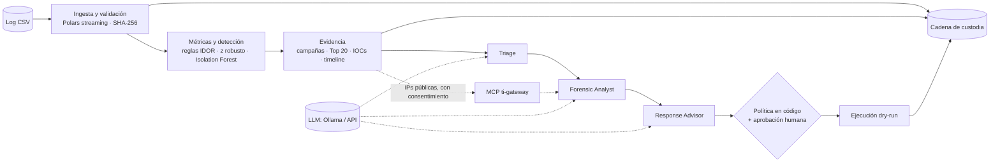

# IR Platform · Investigación y respuesta ante incidentes IDOR

[](https://github.com/ycanon/ir-platform-idor/actions/workflows/ci.yml)


Plataforma para **detectar y analizar la explotación de un IDOR** (*Insecure Direct Object Reference*, BOLA en el
OWASP API Top 10) a partir de logs HTTP, **generar evidencia forense verificable** y **automatizar parcialmente la
respuesta inicial** con agentes de GenAI y aprobación humana, siguiendo el ciclo de respuesta a incidentes de NIST.

Caso de referencia: `GET /invoices/search?invoice_id={id}&site_id={id}&authtoken={token}`, ~4,5 millones de registros
(1,1 GB). La plataforma no está atada a ese endpoint: **detecta del propio dataset** el endpoint, el parámetro con el ID
del objeto, la credencial y el ámbito.

## Funcionalidades

| Área | Qué hace |
|---|---|
| **Pipeline forense** | Ingesta por streaming con Polars (4,5 M filas en ~12 s en CPU), validación de esquema, SHA-256 del original, staging en Parquet y métricas (peticiones por IP, distribución temporal, 401/403 vs 200) |
| **Detección** | Patrones IDOR (enumeración, rangos contiguos de IDs, volumen anómalo) por IP y por credencial, z-score robusto + Isolation Forest y *risk score* explicable de 0 a 100 |
| **Evidencia** | Campañas, fases, *patient zero*, inicio de la explotación, Top 20 IPs con razones, timeline, IOCs (JSON y CSV), respuestas a las preguntas de análisis NIST y TTD |
| **Integridad** | Manifiestos con el hash de cada artefacto y registro de custodia encadenado por hash; comando `verify` |
| **Agentes GenAI** | Triage, Forensic Analyst y Response Advisor en LangGraph; política de aprobación en código, intervención humana, *dry-run*, registro de decisiones y mapeo MITRE ATT&CK validado contra el catálogo |
| **LLM a elección** | Ollama (local o en la red), endpoints compatibles con OpenAI (LM Studio, vLLM) o APIs en la nube; sin LLM, lógica determinista equivalente |
| **Inteligencia de amenazas** | Servidor MCP propio `ti-gateway`: VirusTotal, AlienVault OTX, AbuseIPDB, GreyNoise, IPinfo, Shodan, abuse.ch y MISP |
| **Interfaz web** | FastAPI: carga segura de datasets, progreso en vivo, tableros, evidencia, aprobación de acciones, conversación con los agentes y evaluación de modelos |
| **Observabilidad** | `/metrics` (Prometheus) y perfil de Docker Compose con Prometheus y Grafana (tablero aprovisionado) |

## Inicio rápido con Docker

Requisitos: Docker Engine o Docker Desktop con Compose v2.23+. Funciona en Linux, macOS y Windows.

```bash
git clone https://github.com/ycanon/ir-platform-idor.git
cd ir-platform-idor
cp .env.example .env                 # Windows (PowerShell): Copy-Item .env.example .env
# Linux: que el contenedor pueda escribir en ./data y ./output con su usuario
echo "IRP_UID=$(id -u)" >> .env && echo "IRP_GID=$(id -g)" >> .env

docker compose up -d --build         # → http://127.0.0.1:8000
```

Copie el log a `data/` (o cárguelo desde la interfaz) y pulse **Analizar** en la pestaña *Dataset*.

| Variante | Comando |
|---|---|
| Con un LLM local en contenedor | `IRP_OLLAMA_BASE_URL=http://ollama:11434` en `.env`, luego `docker compose --profile ollama up -d --build` y `docker compose exec ollama ollama pull qwen3:4b-instruct-2507-q4_K_M` |
| Con Ollama ya instalado en el equipo | Sin cambios: el contenedor lo busca en `host.docker.internal:11434` |
| Con observabilidad | Defina `IRP_METRICS_TOKEN` y `GRAFANA_ADMIN_PASSWORD` en `.env` y ejecute `docker compose --profile observabilidad up -d --build` (Prometheus `:9090`, Grafana `:3000`) |

Guía completa, controles de seguridad y solución de problemas: [`docs/DOCKER.md`](docs/DOCKER.md).

## Instalación local (sin Docker)

```bash
python3.12 -m venv .venv
source .venv/bin/activate            # Windows (PowerShell): .\.venv\Scripts\Activate.ps1
pip install -e ".[dev]"
cp .env.example .env
python -m idor_ir serve              # → http://127.0.0.1:8000
```

Detalle por sistema operativo y configuración de Ollama: [`docs/INSTALL.md`](docs/INSTALL.md).

## Uso desde la línea de comandos

```bash
python -m idor_ir analyze --file data/three_months.csv --detection-date 2021-01-12   # pipeline completo
python -m idor_ir agents  --run <RUN_ID> --approve interactive                       # agentes + aprobación humana
python -m idor_ir enrich  --run <RUN_ID> --sources abuseipdb,otx                     # inteligencia de amenazas (MCP)
python -m idor_ir verify  --run <RUN_ID> --file data/three_months.csv                # integridad de un run
python -m idor_ir llm-check                                                          # diagnóstico del LLM
python -m idor_ir eval    --run <RUN_ID> --models qwen3:4b-instruct-2507-q4_K_M,qwen3:8b   # comparar modelos
```

`--detection-date` es opcional: sin ella, el TTD se estima hasta el último registro del log y se marca como estimado.
El perfil del incidente se detecta solo; `--endpoint`, `--object-param`, `--scope-param` y `--token-param` permiten
fijarlo a mano. `python -m idor_ir <comando> --help` muestra todas las opciones.

## Arquitectura



Principio de diseño: **el código establece los hechos y aplica la política; el modelo redacta, prioriza y explica.**
Cifras, fechas, *patient zero*, técnicas MITRE exigidas por la evidencia y objetivos de las acciones salen del código;
una revisión automática corrige o anota cualquier desviación del modelo.

| Ruta | Contenido |
|---|---|
| `src/idor_ir/ingestion/` | Esquema, carga streaming y detección del perfil del incidente |
| `src/idor_ir/detection/`, `anomaly/` | Métricas, detector IDOR, features, Isolation Forest y *risk scoring* |
| `src/idor_ir/forensics/` | Evidencia, respuestas NIST, IOCs, manifiestos y custodia |
| `src/idor_ir/agents/` | Grafo LangGraph, proveedores LLM, política, revisión, chat y evaluación |
| `src/idor_ir/web/` | API e interfaz FastAPI, seguridad y métricas |
| `src/ti_gateway/` | Servidor MCP de inteligencia de amenazas (paquete independiente) |
| `observability/` | Configuración de Prometheus y Grafana |
| `tests/` | Pruebas con datos sintéticos y servicios simulados |

## Resultados de un análisis

Cada ejecución crea `output/<RUN_ID>/`:

| Archivo | Contenido |
|---|---|
| `evidence.json`, `iocs.csv` | Evidencia estructurada e IOCs para SIEM/WAF |
| `metrics.json`, `detection.json`, `profile.json` | Métricas, puntaje por actor y perfil del dataset |
| `manifest.json` | SHA-256 de la fuente y de cada artefacto |
| `custody_intake.json` | Acta de cadena de custodia del archivo, si se cargó por la web |
| `agents/` | Informe de los agentes, registro de decisiones, playbook y artefactos *dry-run* |
| `enrichment/` | Resultado de inteligencia de amenazas |
| `sensitive/`, `work/` | Tokens completos y log normalizado: **acceso restringido**, nunca se sirven por la web |

`output/custody_log.jsonl` es el registro de custodia global. Las cargas web exigen un acta de cadena de custodia: el
archivo queda en solo lectura con su acta (`data/uploads/<archivo>.csv.custody.json`), y el análisis verifica el hash de
la recepción antes de procesarlo.

> `data/` y `output/` no se versionan: los logs y la evidencia contienen credenciales y datos personales.

## Calidad

```bash
pytest                               # pruebas (datos sintéticos, LLM y APIs simulados)
ruff check src tests && ruff format --check src tests
mypy                                 # tipado estricto
```

La integración continua (GitHub Actions) ejecuta lo anterior en Python 3.12 y 3.13, construye la imagen Docker y
hace una prueba de humo del contenedor.

## Documentación

| Documento | Contenido |
|---|---|
| [`docs/SPECS.md`](docs/SPECS.md) | Requisitos, supuestos, decisiones técnicas, agentes, seguridad y limitaciones |
| [`docs/INSTALL.md`](docs/INSTALL.md) | Instalación local en Linux, macOS y Windows; configuración de Ollama |
| [`docs/DOCKER.md`](docs/DOCKER.md) | Despliegue con Docker Compose, perfiles y observabilidad |
| [`docs/MCP.md`](docs/MCP.md) | Servidor MCP `ti-gateway`: fuentes, seguridad y uso desde otros clientes |
| [`SECURITY.md`](SECURITY.md) | Reporte de vulnerabilidades y modelo de amenazas |
| [`CONTRIBUTING.md`](CONTRIBUTING.md) | Cómo contribuir |

## Seguridad

La interfaz escucha solo en `127.0.0.1`, aplica CSP estricta, protección CSRF, validación de cargas y lista blanca de
descargas; las claves de API viven solo en memoria y las acciones de contención nunca se ejecutan sobre sistemas
reales (*dry-run*). Detalle de controles (OWASP Cheat Sheet Series) en [`docs/SPECS.md`](docs/SPECS.md#9-controles-de-seguridad).

## Licencia

[MIT](LICENSE) © 2026 Yeyson Javier Cañón Forero
